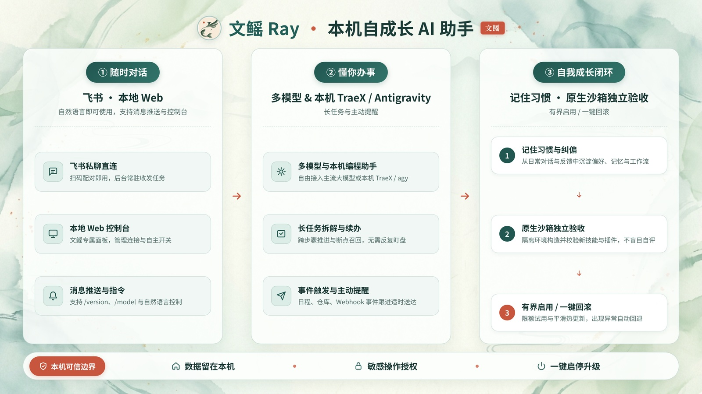

<p align="center">
  
</p>

<h1 align="center">dsh-ray · 文鳐 Ray</h1>

<p align="center">
  <a href="https://www.npmjs.com/package/dsh-ray"></a>
  <a href="LICENSE"></a>
  
  
</p>

**文鳐 Ray**（小名小鳐，出自《山海经》「小鳐小鳐，游而化飞」，基于 [DeepSeek Harness](https://github.com/deepseek-ai/deepseek-harness)）是在本机运行的个人自成长 AI 助手，默认支持 **飞书 + 本地 Web / 桌面端 DSH「文鳐」控制台**使用，可接入主流大模型或本机 **TraeX (`traex`) / Antigravity (`agy`)**，在日常使用与纠偏中积累记忆、生成并沙箱验收新技能与工作流，支持一键启停自迭代与一键升级回滚。**目前为实验版，完整自动闭环的长期真实效果仍在验证中**，能力与限制详见[当前状态](docs/rsi-status.md)。

- **随时对话**：飞书私聊、本机 Web 与桌面端 DSH「文鳐」控制台随时交互，后台常驻运行，支持日程、仓库与 Webhook 主动提醒。
- **懂你办事**：自由选择云端模型或本机 TraeX / Antigravity 编程助手，自动拆解长任务并跨断点推进。
- **自我成长闭环**：从日常对话与纠偏沉淀偏好和经验，在原生沙箱独立验收新技能后有界启用，异常可一键回滚。
- **本机安全护航**：记忆与凭据默认留在本机，敏感操作须经你授权，随时可通过对话或命令行启停自迭代与升级恢复。

## 开始使用

前置条件：Node.js `>=24.9.0`（macOS 原生免 Docker；Linux 需 `systemd --user` 与 `bwrap`）。

**标准安装（推荐：飞书 + 本地 Web + 自成长全能力，交互式向导）**：

```sh
npm i -g dsh-ray && dsh-ray install
```

**纯本地 Web 速览体验（暂不配飞书，一键安装并打开控制台）**：

```sh
npm i -g dsh-ray && dsh-ray install --scenario web --model skip --yes && dsh-ray open --profile web
```

### 桌面端 DSH 左栏插件（`DeepSeek Harness`）

前置条件：已安装 DeepSeek Harness 桌面端（`@deepseek-ai/dsh >=0.2.2-rc.5 <0.3.0`）并至少启动初始化过一次。

1. 打开 DeepSeek Harness 桌面端 → 左侧栏 **插件** → **添加插件** → **安装第三方插件**。
2. 在 **包名或地址** 中填入 `@dsh-ray/owner-console`（本地源码安装须先在仓库根目录执行 `pnpm install && pnpm run build`，再填入 `plugins/owner-console` 的**绝对路径**，如 `/path/to/dsh-ray/plugins/owner-console`），点击 **安装**（无需先装 `@dsh-ray/assistant-web-owner`）。
3. 完全退出并重启桌面端（如 macOS `Cmd+Q` 后重新打开）。重启后左侧栏即出现 **「文鳐」** 入口（及 **设置 → 文鳐助手**），可在面板内直接对话、扫码接入飞书（`lark-channel`）、配置本机编码工具及加装其它 `@dsh-ray/*` 插件。

如需为**已有普通 CLI profile**（非 `desktop`）单独补充控制台插件（标准 `dsh-ray install` 与 `--scenario web` 已默认包含 `@dsh-ray/owner-console`）：

```sh
dsh plugin --profile <profile> add @dsh-ray/owner-console
dsh --profile <profile> --dump-config
# 或通过 dsh-ray 追加安装：
dsh-ray install --profile <profile> --with console
```

> **注意**：
> - `desktop` profile 由 Electron 桌面端独占托管，**不要**执行 npm 版 `dsh plugin --profile desktop`（`dsh` CLI 会直接拒绝）或 `dsh-ray install --profile desktop`（会在准备 Host 后于 `dsh plugin --profile desktop` 步骤失败）。如需用命令行体检或升级桌面端，须先安装 `dsh-ray` CLI（`npm i -g dsh-ray`）并确保已绑定私有 Host 或全局 `PATH` 中存在 `dsh`（`@deepseek-ai/dsh`），再执行 `dsh-ray doctor --profile desktop` 或 `dsh-ray upgrade --yes --profile desktop --confirm-dsh-home-stopped`（升级前需先完全退出桌面端）；否则也可直接在桌面端 UI 的 **插件** 或 **设置 → 文鳐助手** 中管理或升级 `@dsh-ray/owner-console`。
> - **不要**在与桌面端或 Web 端内置 Host 共用的同一 profile 中启用 `@dsh-ray/acp`，否则会触发 `DUPLICATE INSERT ID: cordis-host-runner` 冲突。

### 首次连接（3 步完成）

1. 打开终端向导给出的飞书授权链接，选择或创建机器人并确认权限。
2. 给机器人私聊发送终端显示的最新 `DSH-CONNECT-…` 验证码，以终端提示绑定成功为准。
3. 服务启动后，私聊发送 `/model` 选择模型并确认即可开始对话（更多细节与排障见[安装指南](scripts/install/README.md)与[飞书接入](plugins/lark-channel/docs/setup.md)；暂不接飞书见[只用本机 Web](scripts/install/README.md#只用本机-web)）。

> 安装向导默认自动探测本机已登录的 `traex` / `agy` 或引导配置 DeepSeek API Key（`0600` 存于本机）；新安装默认 `Full access`，如需收紧为写入需人工批准可改用 `dsh-ray install --permission workspace-write`。`dsh-ray open` 输出的 Web 地址含登录令牌，请勿公开分享。

## 架构一览

<p align="center"></p>

1. **双端随行与主动触达**：通过飞书长连接与本地 Web「文鳐」控制台随时对话，可按需接入日历、GitHub 仓库、文件与 Webhook 事件跟进，在合适时机送上精简摘要或通知。
2. **多模型与本机编程助手**：自由接入常用大模型 API 或本机 TraeX / Antigravity，遇到多步骤复杂工作时自动拆解为长任务并持续推进、断点召回。
3. **记住习惯与原生沙箱进化**：从日常对话与纠偏中沉淀你的偏好、联想记忆与高频工作流；新生成的技能或插件先在原生隔离沙箱中独立验收，通过后限额试用与平滑热更新。
4. **可授权、可开关、可回滚**：记忆与凭据留在本机，外部动作与敏感操作受授权边界保护；支持自然语言与命令行一键开启/关闭自迭代、自助升级并自动体检恢复，升级失败自动回滚。

开发者如需了解 40 个发布包（36 个插件 + 4 个共享库）边界与运行时契约，见[架构说明](docs/architecture.md)、[插件目录](plugins/README.md)与[共享包目录](packages/README.md)。

## 日常使用

在飞书或本地 Web 对话中，可直接说“记住我喜欢简短回复”“开启自迭代”“关闭自迭代”“升级整体助手”，或发送 `/version`、`/autonomy enable|disable|upgrade` 控制助手状态。常用 CLI 命令：

| 想做什么 | 命令 |
| --- | --- |
| 打开 Web 与「文鳐」控制台 | `dsh-ray open --profile web` |
| 检查、预演或一键自助升级并恢复 | `dsh-ray upgrade --check` / `--dry-run` / `--yes` |
| 查看助手/Host/插件版本与自迭代统计 | `dsh-ray version [--json]` / `dsh-ray --version` / 聊天 `/version` |
| 一键开启或关闭自迭代能力 | `dsh-ray enable` / `dsh-ray disable`（或对话 `/autonomy enable\|disable`） |
| 只读环境与服务体检（含 `traex`/`agy`） | `dsh-ray doctor [--profile web] [--json]` |
| 查看 Home、绑定 Host 与服务状态 | `dsh-ray status [--json]` |
| 升级全局 `dsh-ray` CLI（加 `--all` 同步升级插件） | `dsh-ray update` / `dsh-ray update --all --yes` |
| 查看只读成长计分卡 | `dsh-ray growth-report --since 7d` |
| 查看最近日志或重启服务 | `dsh-ray logs --profile web --lines 100` / `dsh-ray restart --profile web` |

> 浏览器关闭后，默认安装的常驻服务仍会在后台运行。注意：`dsh-ray reinstall` 会删除旧数据后重装，日常升级请使用 `dsh-ray upgrade --yes` 或 `dsh-ray update`（详见[命令参考](packages/dsh-ray/README.md)与[维护说明](scripts/install/maintenance.md)）。

## 按需阅读

| 需要帮助 | 文档 |
| --- | --- |
| 首次安装、场景选择、安装排障 | [安装指南](scripts/install/README.md) |
| 添加或切换模型（含 `traex` / `agy`） | [模型配置](docs/models.md) |
| 飞书绑定、权限与消息排查 | [飞书接入](plugins/lark-channel/docs/setup.md) |
| `dsh-ray` 完整命令、升级与卸载 | [命令参考](packages/dsh-ray/README.md) |
| 桌面端左栏「文鳐」控制台插件（`@dsh-ray/owner-console`） | [控制台插件](plugins/owner-console/README.md) |
| 已支持能力与当前限制 | [当前状态](docs/rsi-status.md) · [验收合同](docs/rsi-acceptance.md) |
| 全部插件与共享库清单 | [插件目录](plugins/README.md) · [共享包目录](packages/README.md) |

## 参与开发

开发需要 Node.js（`.node-version` 锁定 `24.9.0`，`engines.node >=24.9.0`）和 `pnpm@11.7.0`。本地与远端只保留 `dev` 与 `main`；日常开发在 `dev` 提交推送，发布验证通过后合入 `main`。

```sh
pnpm install
pnpm check
```

协作规范见[贡献指南](CONTRIBUTING.md)与[安全政策](SECURITY.md)，新增插件见[开发指南](docs/creating-a-plugin.md)，包边界见[架构说明](docs/architecture.md)，Linux 门禁见[Linux 验证环境](docs/linux-validation.md)，发版见[发版指南](docs/releasing.md)。更多资料见[文档索引](docs/README.md)。

[MIT License](LICENSE)
