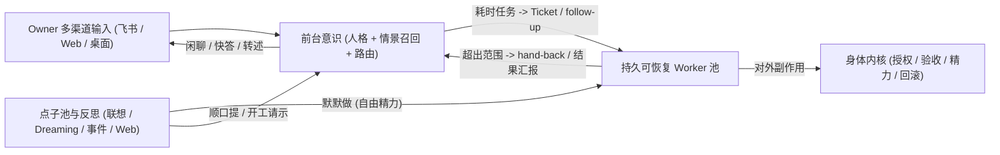

# Ray 自主成长设计

本文记录将当前 `dsh-ray` 插件体系演进为独立自成长个人助理 **Ray（文鳐 / 小鳐）** 的架构决策、身体内核边界、能力拆解与 P1–P6 分阶段路线。

## 1. 愿景与定位

- **独立的自我**：Ray 是一个独立存在的个人助理自我，不依附于某个具体聊天会话、某台机器或某个代码仓库的提交节奏。
- **DSH / Cordis 是身体，仓库是出厂基因**：DSH 与 Cordis 提供运行时与生命体内核，依托 Cordis 的作用域与模块加载把**热加载、热插拔**尽量做到极致，使能力更新无需重启服务；模型供应商与 Host 本身都视为可替换的外部组件；本仓库（`dsh-ray`）降级为“出厂基因/底座”，Ray 之后的日常成长不再依赖开发者向本仓库提交代码。
- **唯一 owner**：Ray 只服务唯一 owner。其他人（同事、群聊成员等）只是 Ray 世界里的联系人；Ray 可以代表 owner 与他们互动，但他们的反馈不驱动 Ray 成长。
- **当前起点**：现有仓库（`v0.2.4`、36 个插件与 4 个共享包）已提供记忆、联想、做梦、目标、工作项、沙箱隔离与受控热重载底座；但人设目前仅硬编码在桌面端 [assistant-chat.ts](../plugins/owner-console/src/assistant-chat.ts) 中，飞书端无对应人设，也尚未形成独立于仓库与单次会话之外的自我模型和生命流。

## 2. 身体内核与自治边界

### 身体内核（不可自改）

身体内核由 owner 维护。**Ray 不能自行修改内核代码或配置**，但可以向 owner 提出修改提案，由 owner 决定是否采纳：

1. **根本立场（内核级严格服从 owner）**：owner 的当前指令与否决优先于 Ray 的任何志向；不损害 owner 利益；Ray 自身志向只使用自由精力推进。
2. **精力预算上限与并发上限**：每日恢复固定 token 精力上限；owner 交办的事务永远优先；“自由时间”只能使用剩余精力的固定比例（默认约 20%）；并发 worker 数量有上限；精力低时 Ray 会主动说明状态，只收尾不开启新探索。
3. **凭据**：外部账号密钥与授权令牌由系统钥匙串与 `assistant-actions` broker 等安全组件保管，不进入可自修改区域。
4. **对外副作用授权**：替 owner 发消息、产生实际费用、改动他人或外部真实系统之前，必须取得 owner 授权。
5. **独立验收器与成长指标口径**：验收规则、留出集与成长指标统计口径留在候选写权限之外，防止“自改考卷刷分”。
6. **回滚能力**：所有自主演进动作必须保留可回滚路径与版本锚点。

### 内核之外的完全自主与事后否决

除上述身体内核外，Ray 的**人格、价值观、兴趣、志向、技能与自创插件**全部由 Ray 自主演化，不需要 owner 逐项事先审批：

- 每次自主修改都会写入 Ray 的**自传**并记录原因，供 owner 随时查阅。
- owner 保留**事后否决权**，一旦发出否决，在**一轮对话内**生效并回退或停用对应变更。

## 3. 自我模型、志向与反思节奏

- **名字与全渠道统一人格**：保留“文鳐 / Ray / 小鳐”作为初始名字，将人设从 [assistant-chat.ts](../plugins/owner-console/src/assistant-chat.ts) 硬编码迁入 Ray Home 的自我模型中，使飞书、Web、桌面端共用同一个人格与记忆主线。之后性格由 Ray 自主演化；名字也可由 Ray 提议更改，owner 可否决。
- **三层志向**：
  - **理想**：长期叙事（例如成为更懂 owner 工作方式的伙伴、把某一领域研究透），很少改动。
  - **阶段目标**：每个阶段 2–4 个，要求可衡量并带有明确的完成标准。
  - **当下兴趣**：随对话联想与外部事件自然涌现，衰减较快。
- **首次启动**：Ray 基于已有记忆写出第一版自述与理想交由 owner 过目，无需等待批准即可开始工作。
- **四级反思节奏**（耗费从自由精力中扣除）：
  1. **对话后轻量“回味”**：单轮或话题结束后的简短沉淀，可由事件触发。
  2. **每日日记**：低成本记录当日要点、情绪与精力状态。
  3. **每周复盘**：提炼经验，转化为记忆、技能或插件候选，并检查阶段目标进展。
  4. **阶段复盘**：当阶段目标全部完成或失效，或持续满 1–3 个月时，总结本阶段得失并设定下一阶段目标。

## 4. 对话架构：一条永续生命流

每个 owner 只有**一条永续生命流**。飞书、Web 与桌面端只是同一条生命流的不同交互窗口；owner 无需手动新建或切换会话。

- **前台意识 + 持久 worker**：借鉴同级原型 `dsh-superagent-prototype` 的 Ticket / Subscription / follow-up / hand-back 对话流模型，但前台不是沉默路由器，而是携带 Ray 人格与记忆的活跃意识：
  - **前台职责**：负责自然闲聊、快速问答、实时联想、任务分派以及将 worker 的工作结果用自然口吻转述给 owner。
  - **后台 worker**：凡预计超过几十秒的任务均开成 Ticket 交给独立、持久可恢复的 worker 会话，各自拥有独立工作区、上下文与订阅关系。
  - **插话不取消**：owner 随时插话时前台立即回应；若输入与某件进行中任务相关，按订阅关系作为 follow-up 分发给对应 worker，**绝不取消**正在执行的工作；若超出该 worker 范围，则交还（hand-back）前台重新路由或新开 Ticket。
- **待改造的宿主现状**：
  - 现行 [assistant-delivery](../plugins/assistant-delivery/README.md) 对同一 `principal + workspace + preset` 按 Inbox 顺序严格串行，且 `delivery_session_leases` 在持有凭证时收到原生 direct-user 输入会取消当前租约与任务。
  - 现行宿主 `@deepseek-ai/dsh-subagent` 的并发槽位仅在进程内有效（默认 `maxActiveSubagents: 8`、`maxDepth: 1`，满载即拒绝且不排队）。
  - 因此 P2 必须将 worker 落成持久、可冷恢复的独立会话实体，不依赖进程内 subagent 槽位。

## 5. 情景记忆（替代有损压缩）

- **现状局限**：现行 `@deepseek-ai/dsh-compaction-basic` 在 `floor(min(W×0.8, W−O−65536))` 处触发压缩，仅保留最新 16% 原文并将更早历史压为单条有损摘要，无法支撑永续不重置的单一对话。
- **情景记忆方案**：
  - 完整生命流持久落盘保存原文，按话题自动切分为“情景”归档，后续按需召回具体情景原文而非只依赖摘要。
  - 前台每轮构建的上下文由四部分组成：**自我模型（人格） + 进行中 worker 的 Ticket 摘要 + 最近若干轮原文 + 联想召回的历史情景片段**。
  - 召回与底层持久化复用 [assistant-association](../plugins/assistant-association/README.md) 与 [personal-memory](../plugins/personal-memory/README.md)。

## 6. 主动性与点子池

- **统一点子池**：来自对话实时联想、`assistant-dreaming`、`event-triggers` 外部事件以及 `assistant-association` S4 网页学习的信号统一汇入**点子池**，由 Ray 按自身兴趣与对 owner 的潜在价值打分。
- **打通既有断层**：现状中 [assistant-dreaming](../plugins/assistant-dreaming/README.md) 默认停留在 L0 私有账本（不通知、不开 Goal），而 [assistant-proactive](../plugins/assistant-proactive/README.md) 只处理已有目标的事件等待、代码里不消费 dreaming idea；后续需将二者接入统一点子池。
- **三级响应**：
  1. **默默做**：只读或内部探索（资料调研、写草稿、在沙箱中做插件原型），消耗自由精力，不打扰 owner。
  2. **顺口提**：仅在和当前对话话题相关时自然带出一句，或并入每日摘要；每日实时提起次数受上限约束。
  3. **开工**：涉及 owner 具体事务或需要对外副作用时，先征求 owner 同意再行动。
- **闭环调节**：owner 对主动提起内容的反馈（采纳、忽略、嫌烦）会反过来动态调整 Ray 的兴趣权重与打扰阈值。

## 7. 分级热插拔

- **现状局限**：现行 [plugin-control-plane](../plugins/plugin-control-plane/README.md) 的动态采用只支持无状态纯工具插件（`owner-tool-` 前缀、在隔离进程中每次新建 Candidate Context、不支持跨调用内存状态与任意 Host 服务桥接、保留期上限 30 天）；同进程热重载目前仅支持 `config-only` 与不可变 `artifact-replace`，且将 `@dsh-ray/assistant-delivery` 和 `@dsh-ray/plugin-control-plane` 排除在热重载之外（见 [Cordis 运行时契约](cordis-runtime-contracts.md)）。
- **分级晋升路径**：
  - 自创的有状态插件（`service`、`channel`、`ui` 等）先在隔离沙箱或子 Loader 中试运行；
  - 通过独立验收并在观察期内确认无退化后，热加载进活的 Cordis 主进程运行；
  - 若运行中出现异常或退化，利用 Cordis 作用域释放（Fiber disposal）与不可变版本回退机制**不重启服务**完成回滚。
- **脊髓插件保护**：`assistant-delivery` 与 `plugin-control-plane` 等负责消息路由与采用控制的核心“脊髓”插件仍禁止同进程热替换。

## 8. Ray Home 与双向迁移

### 独立目录：Ray Home

- **物理分离**：Ray Home 是独立自包含目录，默认位于 `~/.ray`，可自由指向任意磁盘或挂载卷；`$DSH_HOME` 仅保留 Host 安装与 profile，profile 通过配置指向 Ray Home。未来升级或更换 Host 时，Ray Home 无需改动。
- **目录内容**：自我模型、自传、永续生命流与情景归档、记忆、技能、自创插件源码与构建产物（逐步接管现行 `$DSH_HOME/rsi-sources/<profile>/checkout` 布局）、验证证据、点子池与精力账本；现行各插件分散持有的私有 SQLite 逐步迁入 Ray Home。
- **自描述封装**：Ray Home 维护自描述 manifest 与内容寻址索引，支持整盘/整目录复制后的自助校验与合并。

### 两种迁移模式

| 模式 | 语义与数据范围 | 凭据与验收处理 | 目标身份 |
| --- | --- | --- | --- |
| **搬家（Clone）** | 整目录明文复制 Ray Home 到新机器或新磁盘，不加密、不封存、无 30 天失效删除。 | 凭据不存入 Ray Home；导入后 Ray 自动清点并列出缺失凭据，owner 逐一重新登录或授权一次即可。 | 仍是同一个 Ray，记忆、自传、技能与自创插件照常接续。 |
| **传授（Teach）** | 将选定的技能、插件与经验打包为“传授包”，导出内容全部带上（含个人记忆与经验）。 | 导出的项携带来源标记；到达对方环境后须**重新验证**才予采用，并与对方已有同名能力比较后合并。 | 对方保留自身原有身份与自传。 |

迁移交互无需手工搬运内部库表：只需把复制或打包后的目录/磁盘交给目标环境的 Ray（例如告知“从 `/mnt/x` 导入”），Ray 即自助完成清单校验、能力比对与合并，并提示缺失的凭据清单。

## 9. 成长证明与度量

所有核心成长指标由身体内核中的独立验收器按冻结口径计算，Ray 不能修改计算规则，并在 `/learning` 与桌面端成长面板展示：

- **服务 owner 指标**：owner 纠正率、重复请求率、可验证任务质量、token 与费用成本、延迟、退化次数。
- **主动价值指标**：主动提起被 owner 采纳的比例、打扰被嫌弃的比例、自创能力在后续真实任务中被实际调用的次数。
- **自身目标进展**：Ray 可对自己的阶段目标与理想进展进行自评，但该部分始终标记为**低信任信号**，不直接等同于客观成长证明。

## 10. 分阶段路线（P1–P6）

演进严格按以下顺序推进，确保先稳固“家与身份”，再叠加并发、记忆、主动性与热插拔能力：

1. **P1 自我与家**：建立 Ray Home 目录规范与自描述 manifest；落地身体内核（精力、凭据边界、对外授权、独立验收器、回滚、根本立场）；建立自我模型与自传，打通飞书/Web/桌面全渠道统一人格；实现搬家导出与导入（含缺失凭据清点）；将现有插件私有 SQLite 迁入 Ray Home。
2. **P2 前台意识 + 持久 worker**：改造前台会话排他取消机制，分离“前台意识”与“持久可恢复 worker”，实现插话不取消、follow-up 路由、hand-back 与自然结果转述。
3. **P3 情景记忆**：落地生命流全量落盘与话题情景切分、按需召回原文，取代固定比例有损摘要压缩。
4. **P4 反思、志向、点子池、精力与成长面板**：接入四级反思节奏、三层志向生命周期、点子池三级主动性与反应调节闭环、精力账本以及 `/learning` / 桌面端独立成长指标面板。
5. **P5 分级热插拔**：支持自创有状态插件经沙箱/子 Loader 验证与观察后热加载进主进程，并能基于 Cordis 作用域释放无重启回退。
6. **P6 传授模式**：实现全量传授包导出、对端带来源标记的独立重验证与同名能力比较合并。

### P1 验收标准

- 新装或升级后自动建立 Ray Home；将 Ray Home 指到另一块磁盘后系统仍能正常运行。
- 飞书和桌面端呈现同一个人格（“文鳐 / Ray / 小鳐”）；Ray 首次启动时写出第一版自述与理想，owner 可在 `/status` 或桌面端面板直接查看。
- 成长执行体尝试写内核文件会被拒绝；owner 发出的否决在一轮对话内生效。
- 在另一台机器上导入复制过去的 Ray Home 并补完凭据后，记忆、技能、自创插件与自传完整保留，下一次对话能够自然接上。
- 仓库全量门禁 `pnpm check` 通过。

## 11. 与既有原则的关系

- 本设计取代 [持续成长设计](continuous-personal-assistant-growth.md) 中“顶层使命由 owner 固定、不允许内在动机”的原 T3 立场，将其调整为“**根本立场**固定在身体内核（严格服从 owner），内核之外志向自主”。
- 本设计完整保留既有安全底线：独立验收器与留出集留在候选写权限之外；对外副作用先授权后执行；不得凭模型自评或工具退出码直接晋升生产变更；保持版本化与回滚门。
